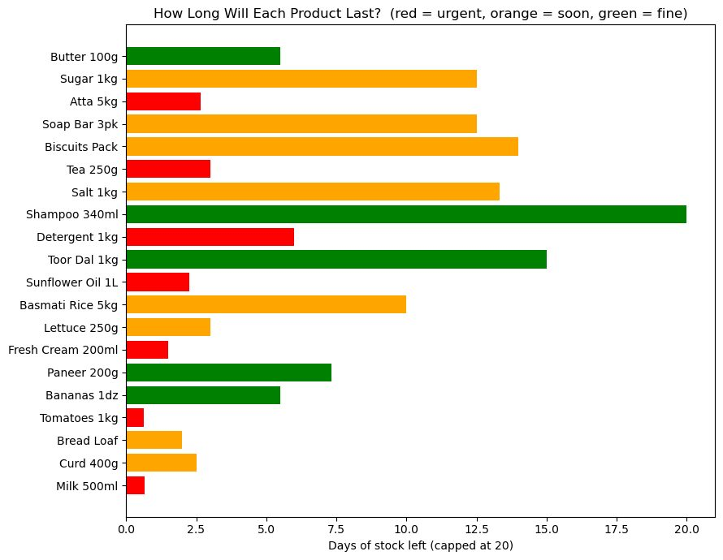

# DMart Store Manager

**Tool:** Python

Menu-driven tool for a 20-product store: stock status, restock planning, billing with discounts and GST, and profit analysis.

## Highlights
- Flags products to reorder (8), healthy (9) or overstocked (3)
- Days of cover with separate limits for perishables and non-perishables
- Tiered discounts, member offer, GST invoice and margin ranking

## Files
- `PORTFOLIO_DMART.ipynb`

Product data is typed into the notebook. The manager password in it is a demo value only.

## How to open
Open `PORTFOLIO_DMART.ipynb` in Jupyter or Google Colab and run all cells. Needs Python 3 and matplotlib.

---
By Faaz Mistry · [LinkedIn](https://www.linkedin.com/in/faaz-mistry-369a11246/) · faazmistry110@gmail.com
